<div align="center">

# ⚡ Recargas PY

### Sistema Inteligente de Recargas USSD para **Tigo (`*888#`)** y **Claro (`*321#`)** Paraguay

**Menos toques, cero errores y máximo control en tu bolsillo.**  
Aplicación Android nativa diseñada para operadores que realizan recargas todos los días: enrutamiento Dual-SIM automático, PIN cifrado con **Android Keystore**, parada obligatoria antes de confirmar y catálogo externo actualizable sin recompilar la APK.

<br/>

[-00C853?style=for-the-badge)](https://github.com/Memorysinc/recargas-py-ussd/releases/latest/download/RecargasPY-v1.0.0.apk)


</div>

---

## 📲 Descarga directa — ¡Sin compilar nada!

No necesitas Android Studio ni conocimientos de programación. Descarga la APK **Release firmada** e instálala directamente en tu teléfono Android:

> ### 👉 [**Descargar `RecargasPY-v1.0.0.apk` (APK lista para instalar)**](https://github.com/Memorysinc/recargas-py-ussd/releases/latest/download/RecargasPY-v1.0.0.apk)
> *Enlace alternativo dentro del repositorio: [`releases/RecargasPY.apk`](releases/RecargasPY.apk) · Compatible con Android 8.0 (API 26) hasta Android 15.*

### Instalación rápida en 3 pasos
1. **Descarga** `RecargasPY-v1.0.0.apk` desde el botón superior y ábrela en tu teléfono (habilita *Instalar aplicaciones desconocidas* si Android lo solicita).
2. **Concede los permisos de teléfono** al abrir la app para detectar tus SIMs de **Tigo** y **Claro** automáticamente.
3. *(Opcional)* Activa el **Asistente USSD (Accesibilidad)** en **Ajustes → Automatización y seguridad** si deseas asistencia automática dentro de los menús interactivos. Consulta la [Guía completa de configuración](docs/CONFIGURACION.md) para Android 13/14/15.

---

## 🚀 ¿Por qué usar Recargas PY?

- **⚡ Velocidad real de mostrador**: olvídate de navegar 5 o 6 menús USSD por cada cliente. Accede directo a montos verificados, paquetes y **Favoritos en 1 toque**.
- **📶 Detección Dual-SIM inteligente**: selecciona automáticamente la `SIM TIGO` para `*888#` y la `SIM Claro PY` para `*321#` (con selector explícito y validación de número por operador).
- **🛡️ Cero cobros accidentales**: el asistente USSD **siempre se detiene antes de la confirmación económica final** del operador y muestra un resumen previo claro antes de marcar.
- **🔐 Seguridad de grado bancario**: los PIN de Tigo y Claro se cifran con **Android Keystore (`AES-256-GCM`)** y requieren **`BiometricPrompt`** (huella, PIN o patrón del teléfono) para verse o editarse. Jamás se guardan credenciales en texto plano.
- **🔄 Catálogo vivo sin reinstalar la APK**: actualiza precios, montos, paquetes, vigencias u opciones USSD desde JSON remoto o archivo local con detección inteligente de cambios (`Diff`), copia de seguridad y restauración en 1 toque.
- **📊 Historial honesto en Room**: nunca marca una operación como *"Completada"* solo por abrir el marcador; registra el resultado real o confirmado por el operador.

---

## 📸 Galería Visual — Todos los Temas y Pantallas

Personaliza completamente la interfaz según tu entorno de trabajo (mostrador iluminado o atención nocturna) y tu color favorito con **Material 3**.

### 🌗 Modo Claro vs. Modo Oscuro (Tigo y Claro Dual-SIM)

<table>
  <tr>
    <td align="center"><b>Tigo • Modo Claro</b><br/>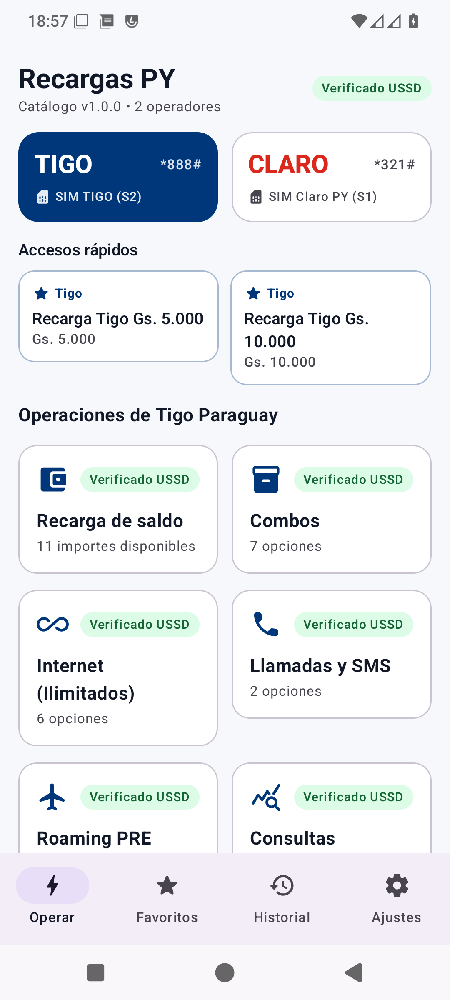</td>
    <td align="center"><b>Claro • Modo Claro</b><br/>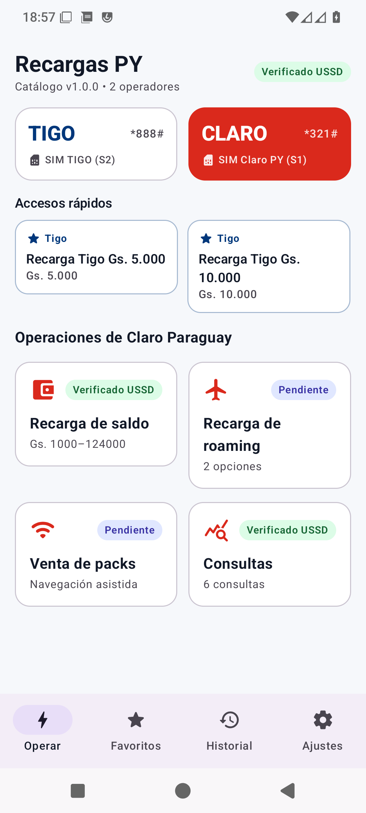</td>
    <td align="center"><b>Tigo • Modo Oscuro</b><br/></td>
    <td align="center"><b>Claro • Modo Oscuro</b><br/>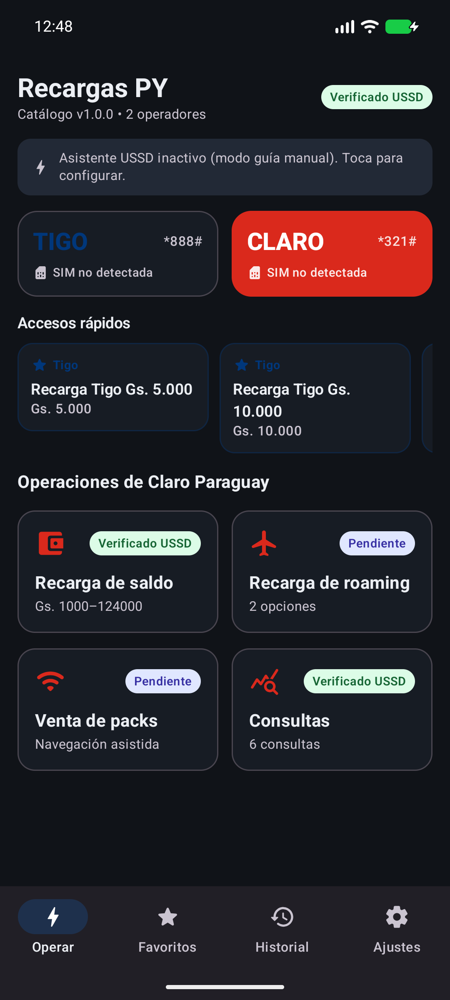</td>
  </tr>
</table>

### 🎨 Las 5 Paletas de Color Personalizadas + Modo Oscuro

<table>
  <tr>
    <td align="center"><b>🔵 Azul (<code>BLUE</code>)</b><br/><sub>#1565C0 • Modo Claro</sub><br/>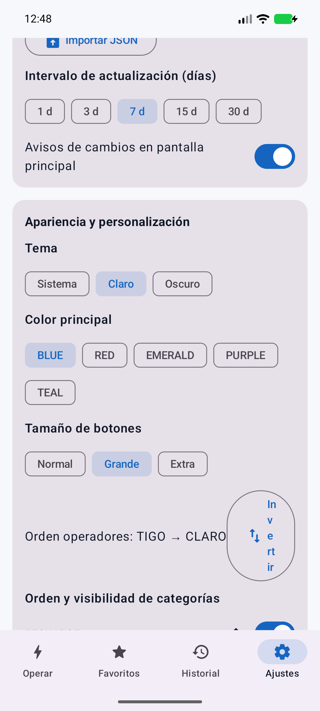</td>
    <td align="center"><b>🔴 Rojo (<code>RED</code>)</b><br/><sub>#C62828 • Modo Claro</sub><br/>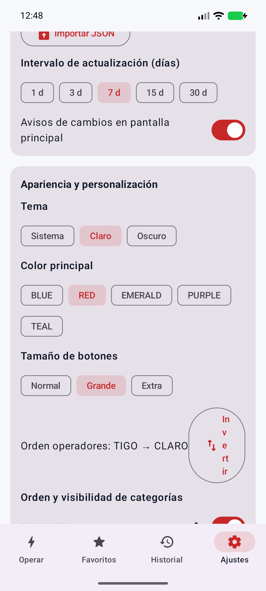</td>
    <td align="center"><b>🟢 Esmeralda (<code>EMERALD</code>)</b><br/><sub>#1B7A4B • Modo Claro</sub><br/>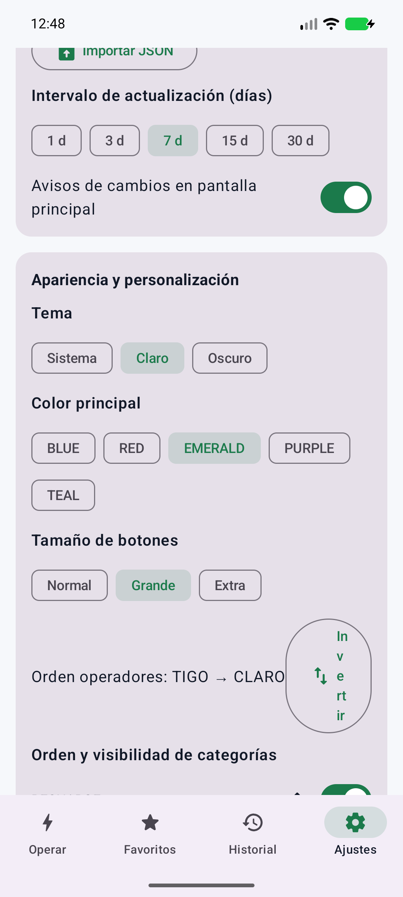</td>
  </tr>
  <tr>
    <td align="center"><b>🟣 Púrpura (<code>PURPLE</code>)</b><br/><sub>#6A1B9A • Modo Claro</sub><br/>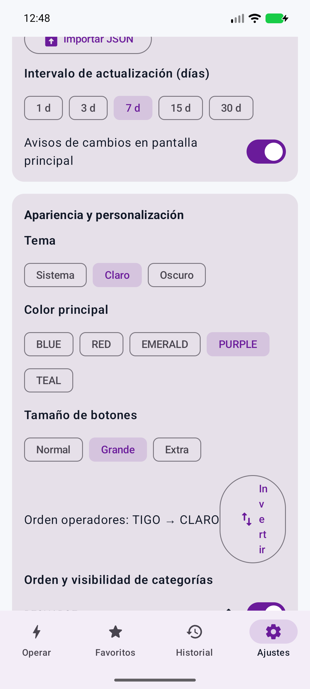</td>
    <td align="center"><b>🩵 Turquesa (<code>TEAL</code>)</b><br/><sub>#00695C • Modo Claro</sub><br/>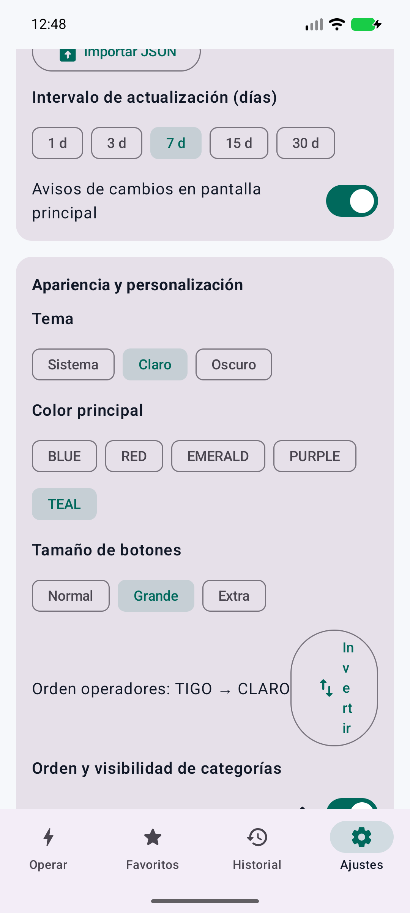</td>
    <td align="center"><b>🌙 Oscuro + Turquesa</b><br/><sub>#00695C • Modo Oscuro</sub><br/>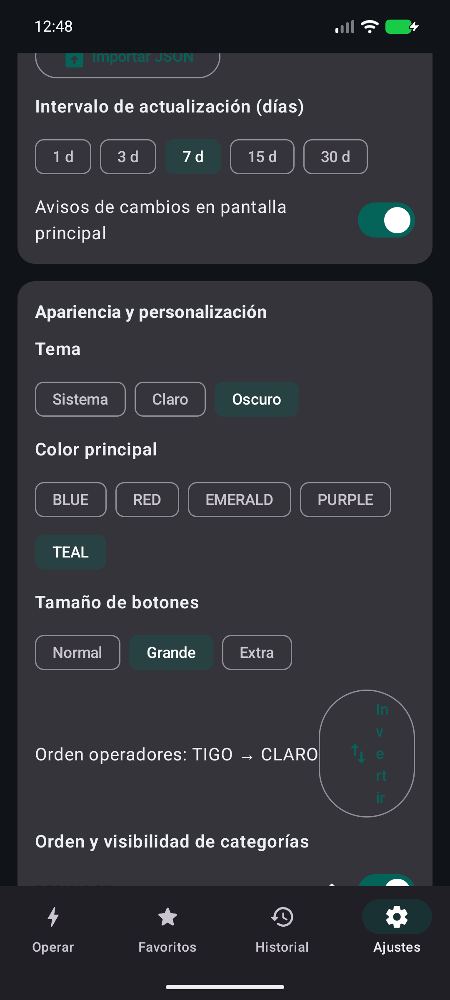</td>
  </tr>
</table>

### ⚡ Operación Rápida, Favoritos, Seguridad y Catálogo Inteligente

<table>
  <tr>
    <td align="center"><b>💸 Flujo de Recarga</b><br/><sub>Importes verificados en 1 toque</sub><br/>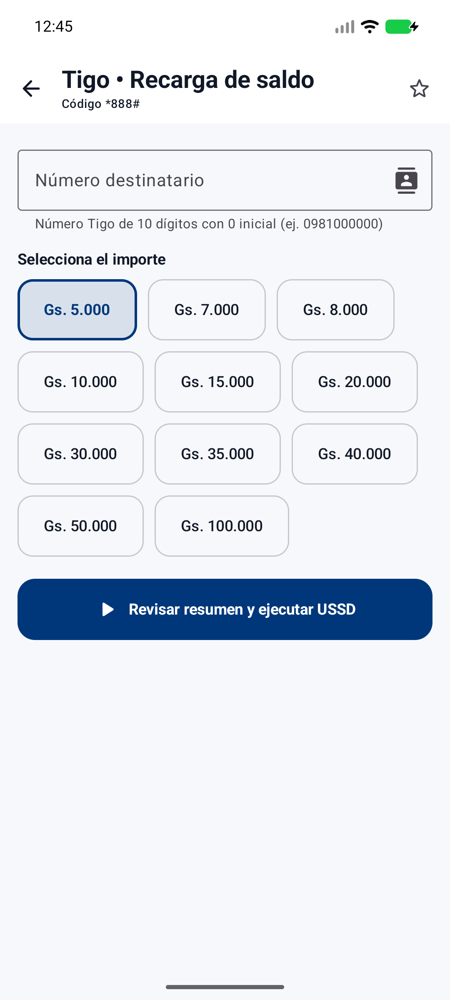</td>
    <td align="center"><b>⭐ Favoritos Rápidos</b><br/><sub>Accesos y números frecuentes</sub><br/>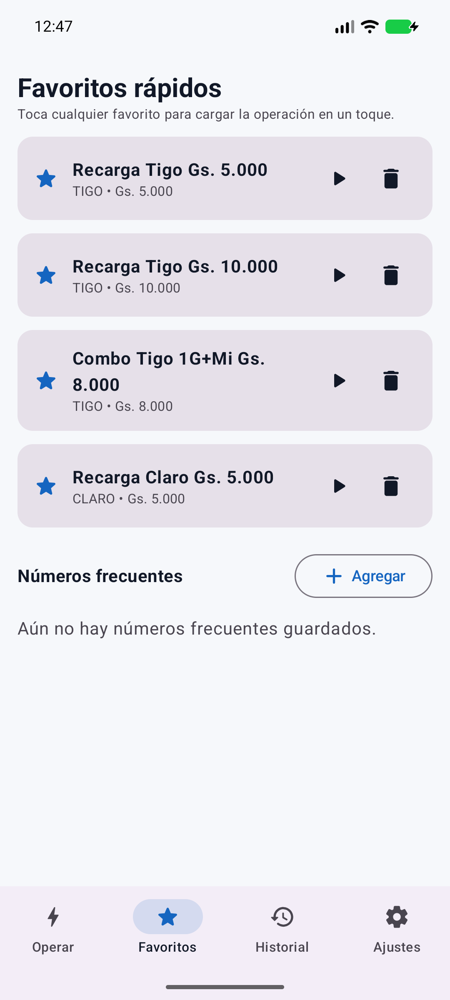</td>
    <td align="center"><b>🔐 Seguridad y Keystore</b><br/><sub>PIN cifrado y Accesibilidad</sub><br/>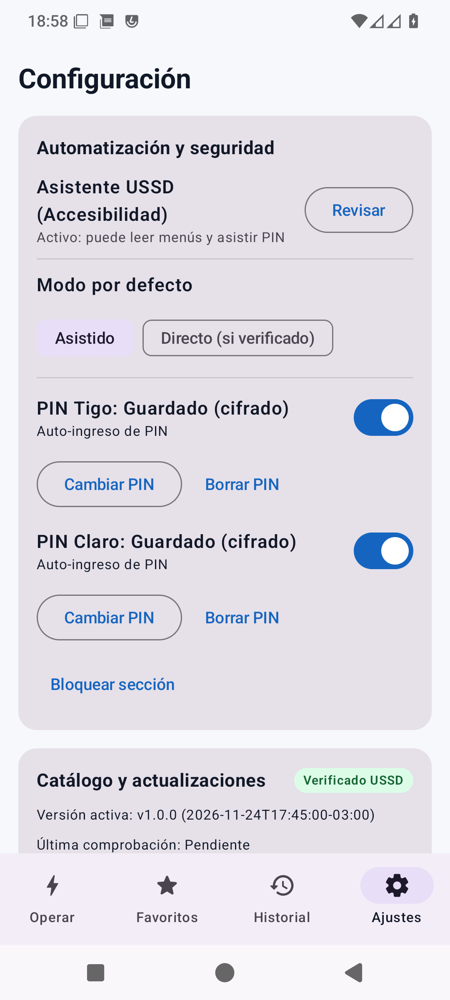</td>
    <td align="center"><b>🔄 Diff de Catálogo</b><br/><sub>Precios, altas y cambios</sub><br/>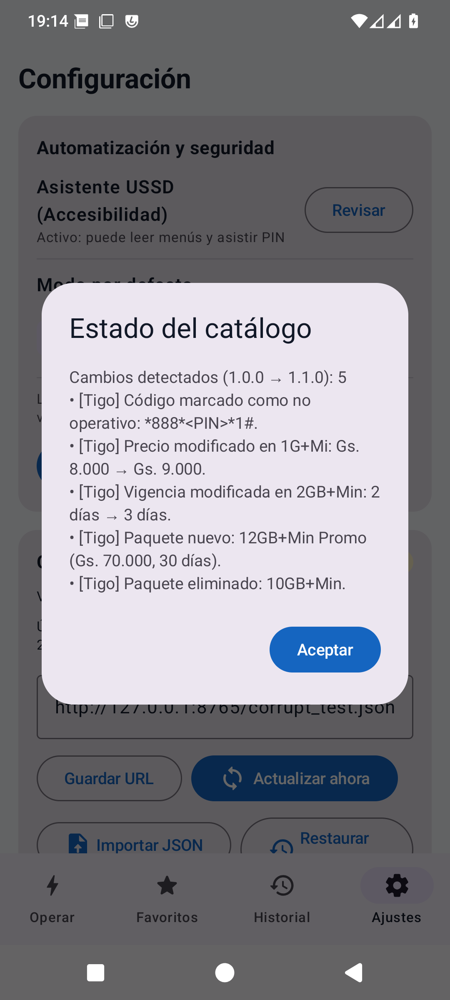</td>
  </tr>
</table>

---

## 📡 Operadores Soportados y Cobertura USSD

Todos los menús, importes y formatos están respaldados por relevamientos reales documentados en [`TIGO/menu.json`](TIGO/menu.json), [`CLARO/menu.json`](CLARO/menu.json) e [`informe_general.md`](informe_general.md), diferenciando claramente lo **Verificado en USSD** de lo **Pendiente / Asistido**.

| Operador | Código USSD | Formato válido | Operaciones disponibles en el catálogo | Nivel de cobertura |
|---|---|---|---|---|
| **Tigo Paraguay** | `*888#` | `098XXXXXXX` *(10 dígitos con `0`)* | **Recarga de saldo** (11 importes de Gs. 2.000 a 100.000), **Combos** (7 opciones), **Internet Ilimitados** (6 opciones), **Llamadas y SMS** (2 opciones), **Roaming PRE** y **Consultas** | `VERIFIED_USSD` |
| **Claro Paraguay** | `*321#` | `99XXXXXXX` *(9 dígitos sin `0` inicial)* | **Recarga de saldo** (rango Gs. 1.000 a 124.000), **Consultas** (6 opciones), **Recarga de roaming** y **Venta de packs** | Recarga y Consultas `VERIFIED_USSD` · Roaming y Packs `PENDING` *(asistido)* |

---

## 🔄 Sistema Inteligente de Actualización (Sin Reinstalar la APK)

La APK viene **preconfigurada de fábrica** apuntando al catálogo público de este repositorio:

```text
https://raw.githubusercontent.com/Memorysinc/recargas-py-ussd/main/catalog/catalog_v1.json
```

Cada vez que actualizas manualmente o mediante la sincronización automática con `WorkManager` (`1`, `3`, `7`, `15` o `30` días):

1. **Validación estricta (`CatalogValidator`)**: rechaza esquemas incompletos, códigos USSD mal formados, precios inválidos, SHA-256 incorrectos o cualquier campo de PIN en texto plano.
2. **Detección inteligente de cambios (`CatalogDiffEngine`)**: compara el catálogo nuevo contra el activo y muestra un reporte claro de **precios modificados**, **paquetes nuevos/eliminados**, **cambios de vigencia** y **códigos rotos (`BROKEN`)**.
3. **Respaldo automático y modo 100% offline**: guarda copia del catálogo anterior (`backup_catalog.json`), permite **Restaurar anterior** en 1 toque y sigue operando sin internet con el último catálogo válido.

> Consulta [`docs/ACTUALIZACION_CATALOGO.md`](docs/ACTUALIZACION_CATALOGO.md) y el catálogo de prueba [`catalog/catalog_v2_sample.json`](catalog/catalog_v2_sample.json) para probar actualizaciones OTA o importar un `.json` local.

---

## 🗂️ Estructura del Repositorio

```text
├── android-app/            # Proyecto Android nativo (Kotlin + Jetpack Compose + Material 3)
├── catalog/                # Catálogos JSON externos (base catalog_v1.json y muestra v1.1.0)
├── docs/                   # Guías de configuración, actualización, registro técnico y galería
├── releases/               # APK Release firmada lista para instalar (RecargasPY.apk)
├── TIGO/ & CLARO/          # Relevamiento estructurado de menús USSD reales (anonimizado)
└── informe_general.md      # Informe consolidado del relevamiento USSD
```

---

<details>
<summary><b>🛠️ Compilar y probar desde código fuente (para desarrolladores)</b></summary>

Requisitos: **JDK 17** y **Android SDK (API 35)**.

```bash
cd android-app
./gradlew testDebugUnitTest assembleDebug
```

Para generar una build `release` firmada con tu propio keystore, crea `android-app/keystore.properties` (ignorado por Git) con `storeFile`, `storePassword`, `keyAlias` y `keyPassword`, y ejecuta:

```bash
./gradlew testDebugUnitTest assembleRelease
```

Más información técnica y evidencias de pruebas en [`docs/REGISTRO_TECNICO.md`](docs/REGISTRO_TECNICO.md) y [`docs/CONFIGURACION.md`](docs/CONFIGURACION.md).

</details>

---

## 📄 Licencia

Distribuido bajo licencia [**MIT**](LICENSE).  
*Nota: Proyecto independiente de asistencia USSD para operadores en Paraguay; las marcas Tigo y Claro pertenecen a sus respectivos titulares.*
