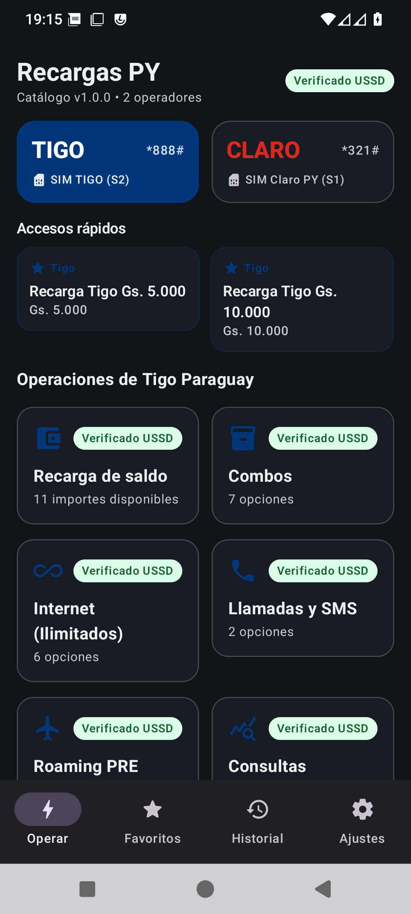

# Recargas PY — Sistema Inteligente USSD (Tigo y Claro Paraguay)

Aplicación Android nativa (**Kotlin + Jetpack Compose + Material 3**) para administrar y asistir operaciones USSD de **Tigo Paraguay (`*888#`)** y **Claro Paraguay (`*321#`)** en teléfonos Dual-SIM, con catálogo externo actualizable sin reinstalar la APK y almacenamiento de credenciales cifrado con Android Keystore.

---

## Capturas principales

| Inicio Tigo | Inicio Claro | Seguridad y Ajustes | Actualización Diff | Tema Oscuro |
|---|---|---|---|---|
|  |  |  |  |  |

---

## Funcionalidades principales

- **Operación rápida en pocos toques**: selector Dual-SIM automático (`SIM TIGO` / `SIM Claro PY`), carriles de favoritos rápidos, números frecuentes con contador de uso, selector de contactos y validación de formato por operador (`098XXXXXXX` en Tigo; `99XXXXXXX` en Claro).
- **Motor USSD seguro (Modo Asistido)**:
  - `UssdAccessibilityService` navega los menús USSD e ingresa el PIN cifrado solo cuando corresponde y está habilitado.
  - **Parada obligatoria antes de confirmar**: se detiene siempre en la pantalla final de confirmación del operador; nunca confirma recargas ni compras económicas de forma automática.
  - Si Accesibilidad está desactivada, pasa automáticamente a **Modo Asistido Manual** con guía paso a paso.
- **Automatización y seguridad**:
  - PIN independiente para Tigo y Claro cifrado con **Android Keystore (`AES-256-GCM`)**.
  - Protección de acceso mediante **`BiometricPrompt`** (huella, PIN o patrón del dispositivo).
  - Cero credenciales en texto plano en JSON, código, base de datos o logs.
- **Sistema inteligente de actualización del catálogo**:
  - Catálogo desacoplado de la APK en [`catalog/catalog_v1.json`](catalog/catalog_v1.json).
  - Comprobación al iniciar, sincronización periódica con `WorkManager` (`1`, `3`, `7`, `15` o `30` días), actualización manual desde URL e importación desde archivo JSON local.
  - Validación de esquema + rechazo de PINs en claro, detección automática de cambios (`CatalogDiffEngine`), respaldo previo con **Restaurar anterior** y soporte 100% offline.
- **Historial y personalización**:
  - Base local **Room** con estados honestos (`Completada`, `Cancelada`, `Fallida`, `Desconocida`) y repetición en 1 toque.
  - **DataStore** con tema (Sistema/Claro/Oscuro), paleta de color, tamaño de botones, orden de operadores/categorías y restauración a valores originales.

---

## Estructura del repositorio

```text
├── android-app/            # Proyecto Android nativo (Kotlin + Jetpack Compose + Material 3)
├── catalog/                # Catálogos JSON externos (base v1.0.0 y ejemplo v1.1.0 para pruebas)
├── docs/                   # Guías de configuración, actualización, registro técnico y screenshots
├── releases/               # APK compilada lista para instalar (RecargasPY.apk)
├── TIGO/ & CLARO/          # Relevamiento estructurado de menús USSD (anonimizado)
└── informe_general.md      # Resumen del relevamiento USSD
```

---

## Actualización directa desde GitHub

Una vez subido este repositorio a GitHub, puedes usar la URL Raw como fuente externa dentro de **Ajustes → Catálogo y actualizaciones**:

```text
https://raw.githubusercontent.com/<TU_USUARIO>/recargas-py-ussd/main/catalog/catalog_v1.json
```

Consulta [docs/ACTUALIZACION_CATALOGO.md](docs/ACTUALIZACION_CATALOGO.md) para ver el esquema completo y cómo publicar cambios de precios o paquetes sin recompilar la APK.

---

## Compilación y pruebas

Requisitos: **JDK 17** y **Android SDK (API 35)**.

```bash
cd android-app
./gradlew testDebugUnitTest assembleDebug
```

La APK resultante se genera en `android-app/app/build/outputs/apk/debug/app-debug.apk`. Consulta [docs/CONFIGURACION.md](docs/CONFIGURACION.md) para permisos, Accesibilidad en Android 15 y seguridad, y [docs/REGISTRO_TECNICO.md](docs/REGISTRO_TECNICO.md) para el detalle técnico y evidencias de pruebas.

---

## Licencia

Distribuido bajo licencia [MIT](LICENSE).
